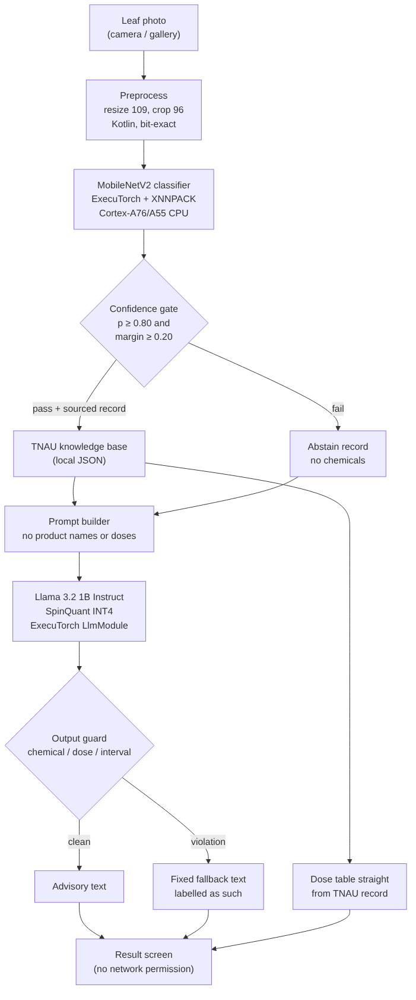

# Summary

AGRI-SHIELD AI is an Android application for tomato growers. It photographs a leaf, classifies it into one of four conditions on the phone's CPU, and writes a short advisory with Llama 3.2 1B through ExecuTorch, with no network connection at any point. Product names and doses are never generated by the language model. They are shown from a local knowledge base copied from the Tamil Nadu Agricultural University (TNAU) Agritech portal, and only when the classifier is confident.

Repository: https://github.com/vigneshh14/AGRI-SHIELD-AI

| Item | Result | Tag |
| --- | --- | --- |
| Classifier accuracy, held-out PlantVillage (936 images) | 0.9562, macro F1 0.9506 | [DESK] |
| Classifier accuracy, PlantDoc field images (350, never trained on) | 0.3914, macro F1 0.3629 | [DESK] |
| Random-split leaf-level contamination avoided | 63.97% of test images (lower bound) | [DESK] |
| Classifier latency on the phone, airplane mode | 12.538 ms median, 17.903 ms max, 23.7 MB peak RSS | [ARM-PROOT] |
| Phone vs x86 numerical agreement | 8/8 top-1, max logit difference 2.384e-6 | [ARM-PROOT] |
| Android app with Llama advisory stage | builds in CI; 31 app unit tests and 73 advisory safety checks pass | [DESK] |
| Llama 3.2 1B advisory executed on the phone | not yet (see section 3.6) | none |

Every number in this report carries one tag. [DESK] means measured on an x86 development machine. [ARM-PROOT] means measured on the target phone's own Arm cores, inside a Debian userland under proot on Android, not inside the Android app. [ARM] would mean measured inside the native app on the phone; no [ARM] figure exists yet, and none is claimed.

# 1. Problem and scope

Problem Statement 1 asks for an assistant that identifies crop disease from a photograph, recommends treatment, supports a local language and runs entirely on the device. A Llama-family model must produce the advisory, and ExecuTorch must be the runtime on Arm hardware.

Two facts about the user shaped every design decision. A smallholder farmer in rural Tamil Nadu often has no reliable connectivity in the field, so nothing may depend on a server. And the farmer acts directly on the output: a wrong pesticide or a wrong dose costs money and can harm health. The second fact matters more than the first. It is why the language model in this system explains, but never prescribes.

Phase 1 scope is deliberately narrow: one crop (tomato), four classes (early blight, late blight, Septoria leaf spot, healthy), English advisory text with Tamil disease names, and one target device.

Target device: Infinix NOTE 30 5G (X6711), MediaTek Dimensity 6080 (MT6833GP), 2x Cortex-A76 at 2.4 GHz plus 6x Cortex-A55 at 2.0 GHz, 7.44 GiB RAM, Android 14 (API 34). No Raspberry Pi was available, and a phone is what a farmer actually carries.

# 2. Methodology

## 2.1 System architecture

{ width=36% }

The pipeline has two safety points. The confidence gate decides whether any treatment may be shown at all. The prompt builder then gives Llama the diagnosis, symptoms and field practices, but never a product name or a dose, so the model has nothing to repeat and nothing to alter. Doses reach the screen through a separate path, straight from the knowledge-base record.

## 2.2 Dataset and the leakage-safe split

| Property | Value |
| --- | --- |
| Training source | PlantVillage [1], raw/color, 4 tomato classes, 6271 images |
| Split | 4390 train / 945 validation / 936 test |
| External test set | PlantDoc [2], CC BY 4.0, never used in training |

PlantVillage photographs each physical leaf four times. The dataset ships a human-annotated leaf map (`leaf-map.json`, built from the authors' annotation spreadsheets) that gives each image a leaf identity. Applying it shows that a random split would put another photograph of the same leaf in the training set for 63.97% of test images. That is a lower bound, because 1919 of 6271 images carry no leaf identity.

The usual remedy, perceptual-hash de-duplication, finds almost none of this. The four photographs of a leaf are rotated and reflected, and an 8x8 gradient hash separates same-leaf from different-leaf pairs at chance (28.1 vs 29.0 bits). A rotation-invariant hue-saturation histogram separates them with AUC 0.963. Hashing would have estimated contamination at 0.64%, two orders of magnitude low.

The split therefore groups images by leaf identity (official map 3918 images, decimal filename heuristic 414, perceptual hash 20, singletons 1919), assigns whole groups to one split, stratifies by class with seed 1337, and is audited: 0 of 3175 leaf groups span two splits.

## 2.3 Classifier and training

| Setting | Value |
| --- | --- |
| Architecture | MobileNetV2 [5], 4 outputs |
| Initialisation | random (ImageNet weights could not be downloaded in the build environment) |
| Input | 1 x 3 x 96 x 96, RGB, ImageNet mean/std normalisation |
| Preprocessing | resize shorter side to 109 (bilinear), centre-crop 96 |
| Optimiser | AdamW, lr 1e-3, cosine schedule, weight decay 1e-4 |
| Loss | cross-entropy, label smoothing 0.05 |
| Batch / epochs | 32 / 22, best-validation checkpoint |
| Training hardware | 2-core x86 CPU, 1450.3 s wall clock |

An independent audit script (17 checks, all passing) reproduces the accuracy from the checkpoint and caught one real defect during the project: an earlier figure had been measured on the final-epoch model while the exported model came from the best-validation checkpoint. That figure was retracted.

## 2.4 ExecuTorch export and on-device runtime

The best checkpoint was exported with ExecuTorch 1.5.1 (torch 2.15.0) through `to_edge_transform_and_lower` with the XNNPACK partitioner. Inspection of the resulting `.pte` shows the whole graph delegated to XNNPACK: the program section is 15,616 bytes against an 8.87 MB constant segment, and the file contains no undelegated ATen operator. The exported model agrees with PyTorch on 60/60 test inputs, maximum logit difference 3.457e-6.

The Android app (Kotlin, `org.agrishield.ai`, minSdk 28, target API 34) loads the model through `org.pytorch:executorch-android:1.5.1`. It checks the model's SHA-256 before loading and refuses to run on a mismatch. Preprocessing was rewritten in Kotlin and matched against torchvision bit-exactly over 9 image geometries (maximum difference 0.0), including Python's round-half-to-even behaviour, which Java's `Math.round` does not share. The comparison feeds both sides identical decoded pixels; whether Android's JPEG decoder produces the same pixels as Pillow for the same file has not been tested.

## 2.5 Treatment knowledge base

Four records, one per class, stored in `knowledge_base/tomato_tnau_v2.json`. Each disease record carries the TNAU Agritech page it was copied from. Every chemical row was read from the page twice on 13 November 2026 with independently worded queries, and every row matched in both reads.

| Disease | TNAU products listed | Unit as printed |
| --- | --- | --- |
| Early blight | 9 alternatives, plus Trichoderma asperellum seed treatment | per acre |
| Late blight | 5 alternatives, plus Trichoderma soil application | per acre |
| Septoria leaf spot | 1 (fluxapyroxad + pyraclostrobin SC) | per hectare |
| Healthy | none | none |

TNAU gives no spray interval for these diseases, so the app says that and refers the farmer to the extension officer and the product label rather than inventing one. The Septoria dose is shown per hectare as printed, not converted. A generator script turns the JSON into Kotlin, and CI fails the build if the two ever differ.

## 2.6 Advisory: gate, prompt, Llama, guard

1. Gate. The app advises only when top-1 probability is at least 0.80 and the margin to the runner-up class is at least 0.20 (the same near-tie rule the result screen already uses to flag an unreliable answer), and only for a record with a verified source. Anything else becomes an abstain record with no chemical fields.
2. Prompt. A Llama 3 instruct prompt containing the diagnosis, pathogen, symptoms and field practices. It contains no product names and no doses in either path; a test sweeps every class at 7 confidence levels and checks that no chemical name or dose string appears in any of the 28 prompts.
3. Llama. Llama 3.2 1B Instruct, SpinQuant INT4 (section 5.2), run through ExecuTorch's `LlmModule` on a single worker thread, temperature 0.2, 768-token sequence. Tokens stream to the screen as they are generated.
4. Output guard. The generated text is rejected if it names any knowledge-base ingredient or one of 31 other common pesticides or brand names, states a dose (number plus %, ml, g, kg or litre), or states a spray interval. A rejected answer is replaced by fixed text built from the record and labelled on screen as a fallback. The guard is a blocklist and cannot catch every phrasing; the real protection is that the prompt never contained the information.

## 2.7 Verification method

- Claim tags on every number, and separate result files per tag (`model/RESULTS.md` for [DESK], `benchmarks/results_arm_proot.md`, `benchmarks/results_arm.md`).
- Two GitHub Actions workflows on every push: the advisory safety tests (73 checks, compiled with warnings as errors) and the Android build (31 JVM unit tests, then `assembleDebug`). The latest build is published as a pre-release APK.
- File identities by SHA-256: classifier `f57f5ec3...37f4b`, Llama `.pte` `8715cdba...1cda3b`, tokenizer `82e9d319...551b55`.

# 3. Results

## 3.1 In-domain accuracy [DESK]

| Metric | Value |
| --- | --- |
| Accuracy | 0.9562 (895 / 936) |
| Macro precision / recall / F1 | 0.9561 / 0.9464 / 0.9506 |

| Class | Precision | Recall | F1 |
| --- | --- | --- | --- |
| Early blight | 0.9478 | 0.8581 | 0.9007 |
| Late blight | 0.9381 | 0.9545 | 0.9463 |
| Septoria leaf spot | 0.9591 | 0.9773 | 0.9681 |
| Healthy | 0.9793 | 0.9958 | 0.9875 |

Early blight is the weak class; 15 of its 148 test images were called late blight.

![Confusion matrix, held-out PlantVillage test set (936 images). [DESK]](confusion_matrix.png){ width=48% }

## 3.2 Field generalisation on PlantDoc [DESK]

| Protocol | Images | Accuracy | Macro F1 |
| --- | --- | --- | --- |
| Primary: 3 unambiguous disease classes | 350 | 0.3914 | 0.3629 |
| Sensitivity: 4 classes, "Tomato leaf" taken as healthy | 413 | 0.3414 | 0.2782 |

Accuracy falls 56.5 points from laboratory to field photographs, and the model stays confident while wrong: mean confidence 0.8124 on errors against 0.8644 on correct answers. This reproduces the 2026 finding of [4] on a different model and subset.

| Confidence threshold | Coverage | Accuracy on answered |
| --- | --- | --- |
| 0.0 | 1.000 | 0.3914 |
| 0.7 | 0.800 | 0.425 |
| 0.9 | 0.489 | 0.4737 |
| 0.95 | 0.277 | 0.5979 |

Thresholding does not repair it. The app's own gate (0.80 plus the 0.20 margin rule) was not separately evaluated on PlantDoc; its operating point lies between the 0.7 and 0.9 rows. This result is why the advisory's safety rests on what the prompt contains, not on confidence.

## 3.3 Classifier on the phone [ARM-PROOT]

The exported classifier ran on the Infinix NOTE 30 5G's own cores with ExecuTorch 1.5.1 and XNNPACK: 50 timed iterations after 10 warm-up, batch 1, input 1 x 3 x 96 x 96, threads not pinned. The runner checked the model's SHA-256 before every run.

| Run | Median | Mean | SD | P90 | P99 | Min | Max | Peak RSS |
| --- | --- | --- | --- | --- | --- | --- | --- | --- |
| Radios on | 14.328 ms | 14.840 ms | 4.095 ms | 17.458 ms | 31.143 ms | 10.303 ms | 39.080 ms | 23.7 MB |
| Airplane mode | 12.538 ms | 13.086 ms | 1.954 ms | 15.984 ms | 17.857 ms | 10.059 ms | 17.903 ms | 23.7 MB |

The minimum barely moved (10.303 to 10.059 ms) while the maximum fell 54% (39.080 to 17.903 ms). That pattern is interference, not throughput: with radios on, background modem activity pushes the unpinned inference thread off the two A76 cores onto an A55. Offline is the deployment condition, so 12.538 ms is the representative figure, about 80 classifications per second.

These runs were inside Debian under proot, not in the native app. proot intercepts system calls; its overhead was not quantified, so no native-app latency is claimed.

## 3.4 Cross-architecture correctness [ARM-PROOT]

Same model file and same input bytes on the phone and on x86: 8/8 top-1 agreement, maximum absolute logit difference 2.384e-6, maximum 15 ULP. The vectors are not bit-identical, which is expected: the phone runs real NEON fused multiply-adds in a different order. The narrowest top-1 margin across the 8 inputs is 0.5082 logits, about 213,000 times the largest difference, so this rounding cannot change a prediction.

The 8 inputs are synthetic tensors made for numerical comparison. They say nothing about accuracy, and no accuracy claim is drawn from them.

## 3.5 Application build and safety tests [DESK]

| Check | Result |
| --- | --- |
| Advisory safety tests (gate, 28-prompt leak sweep, guard, engine end to end with an ExecuTorch API stub) | 73 / 73 pass on every push |
| App JVM unit tests (preprocessing, inference guard, memory plan, orientation) | 31 pass |
| Debug APK, `assembleDebug` in CI | builds; 23,318,143 bytes |

The first CI build found two real compile errors in the classifier code: in executorch-android 1.5.1 `isTensor` and `dataAsFloatArray` became Kotlin properties. Both were fixed against the tagged 1.5.1 sources. The app had never been compiled before CI existed, because Android Studio could not be installed on the 8 GB development laptop.

## 3.6 Llama on the phone: status

The Llama stage is integrated in the app, compiles against executorch-android 1.5.1, and is exercised end to end in the JVM tests through a stub with the real `LlmModule` signatures. The model files are downloaded and verified (Llama `.pte` 1,135,951,488 bytes, matching the publisher's SHA-256). Meta's model card lists the same file as 1083 MB.

As of 27 November 2026 it has not produced an advisory on the phone. The APK and both model files have to be copied to the phone over ADB, and the phone was not detected by ADB on the development laptop. No Llama latency, token rate or memory figure from the phone is therefore reported here, and the reference figures in section 5.2 are Meta's measurements on a different phone, quoted as such.

This leaves the mandatory requirement that Llama runs on the device through ExecuTorch unmet in Phase 1. The remaining work is the device connection; no code or model is missing.

# 4. Hardware utilisation

## 4.1 Where each stage runs

| Stage | Hardware | Runtime | Precision |
| --- | --- | --- | --- |
| Preprocessing | CPU, app thread | Kotlin | float32 |
| Disease classifier | CPU (Cortex-A76 / A55), XNNPACK threadpool | ExecuTorch 1.5.1 | float32 |
| Gate, prompt, guard, dose table | CPU | Kotlin | n/a |
| Llama 3.2 1B advisory | CPU, XNNPACK + KleidiAI kernels | ExecuTorch `LlmModule` | INT4 weights, 8-bit activations |

Everything runs on the CPU cluster. The Dimensity 6080's GPU and MediaTek's own AI processor are not used: ExecuTorch's XNNPACK backend targets the CPU, and keeping both models on one well-supported backend took priority over a second, vendor-specific delegate in Phase 1.

## 4.2 CPU features that matter

The phone reports Armv8.2-A with the dot-product extension (`asimddp`), and no `i8mm`, no BF16 and no SVE. An earlier draft of this report stated that the device supports I8MM; that was wrong and has been withdrawn, along with a Raspberry Pi 5 comparison that depended on it. The practical consequence: KleidiAI's INT4 matrix-multiply kernels have an I8MM path (Armv8.6+) and a dot-product path, and on this phone only the dot-product path can run. Any Llama throughput measured on this device will be a dot-product-path figure.

ExecuTorch's CPU detection on the phone correctly reported 6 efficiency cores. On a 2+6 core layout, which cores the inference threads land on matters more than raw thread count, as section 3.3 shows.

## 4.3 Memory and storage

| Item | Size | Source |
| --- | --- | --- |
| Classifier `.pte` | 8.891 MB | file [DESK] |
| Classifier peak RSS during inference | 23.7 MB | [ARM-PROOT] |
| Llama `.pte` (SpinQuant INT4) | 1,135,951,488 bytes (1083 MiB) | file, SHA-256 verified |
| Llama tokenizer | 2,183,982 bytes | file, SHA-256 verified |
| Llama RSS, Meta's reference on OnePlus 12 | 1,921 MB | model card [6], not measured here |
| Debug APK (models not bundled) | 23,318,143 bytes | CI |
| Phone RAM | 7.44 GiB | device |

The two models together need roughly 2 GB of the phone's 7.44 GiB on Meta's figure, so both can stay resident. The models are not bundled in the APK. The 1.1 GB Llama file would make the APK impractical to distribute, so both models are copied once to the app's own folder, which needs no storage permission. The classifier is SHA-checked there before every load.

Power and thermal behaviour were not measured. The thermal zones were unreadable without root, and no inline power meter was available. No figure is claimed for either.

# 5. Optimisation techniques

## 5.1 Applied and measured

1. Small model, small input. MobileNetV2 at 96 x 96 keeps the classifier at 8.891 MB and 23.7 MB peak RSS, and 12.538 ms median on the phone [ARM-PROOT].
2. Full XNNPACK delegation. The whole classifier graph is one XNNPACK delegate blob with no fallback operators, so no slow portable kernels run on the phone (section 2.4).
3. Offline operation as a latency control. Airplane mode cut the classifier's worst case from 39.080 to 17.903 ms and its standard deviation from 4.095 to 1.954 ms, by removing scheduler interference [ARM-PROOT].
4. Bit-exact preprocessing on the device. Given the same decoded pixels, the Kotlin resampler matches torchvision exactly (9/9 cases, 248,832 values, maximum difference 0.0), so the desktop accuracy is not lost to a preprocessing mismatch. The JPEG decoder itself is the one link not yet compared.

## 5.2 Applied, not yet measured on this phone

5. 4-bit Llama. The advisory model is Meta's SpinQuant checkpoint: linear-layer weights in 4-bit groups of 32, 8-bit per-token dynamic activations, and 8-bit per-channel embedding and output layers [6]. Meta reports, on a OnePlus 12 CPU with ExecuTorch, 50.2 tokens/s decode against 19.2 for BF16, and a 1083 MB file against 2358 MB. Those are Meta's numbers on a faster phone, not this project's measurements.
6. Short prompts by design. Keeping product names and doses out of the prompt shortens it as well as making it safer. The 768-token sequence leaves room for the Llama 3 template, the record and a 4-6 sentence answer.
7. One model load, reused. The Llama module is created once per result screen on its own worker thread and freed with a bounded wait on exit, so the roughly 1 GB of model memory is released before the screen closes.

## 5.3 Identified, not yet applied

8. INT8 classifier through PT2E quantisation with the XNNPACK quantizer. Arm's ExecuTorch course measured MobileNetV2 at 10.89 ms float32 against 4.01 ms INT8 on a Raspberry Pi 5, which has the same Cortex-A76 cores. Not done here; it would need re-validation of accuracy on both test sets.
9. Thread placement on the two A76 cores, for both models.
10. ImageNet-pretrained initialisation, the most likely way to raise field accuracy above 39%.

# 6. Limitations

1. Llama has not yet produced an advisory on the phone (section 3.6).
2. Field accuracy is 39.1%. The app warns about this on screen, and it is not fit for unsupervised field use.
3. One crop and four classes; no pest detection.
4. The output guard is a finite blocklist. Safety rests on the prompt never containing the information.
5. Confidence is raw softmax, not calibrated.
6. The Tamil disease names have not been reviewed by a native agricultural extension speaker.
7. Severity banding exists in the desktop prototype but is not in the Android app. It is unreliable without leaf segmentation: compositing a healthy leaf onto a soil background raised its lesion fraction from 0.004 to 0.93.
8. The classifier phone figures come from a proot userland, not the native app.
9. No power or thermal measurement.

# 7. Next steps (Phase 2)

1. Run the Llama advisory on the phone, then record decode rate, prefill rate, latency and memory over 10 runs in airplane mode, tagged [ARM].
2. Retrain with ImageNet initialisation and calibrate confidence; re-measure PlantDoc.
3. INT8 classifier and A76 thread placement, measured against the float32 baseline above.
4. Chilli and potato records from TNAU, and a pest subset.

# References

[1] S. P. Mohanty, D. P. Hughes and M. Salathe, "Using deep learning for image-based plant disease detection," Frontiers in Plant Science, 7:1419, 2016.

[2] D. Singh et al., "PlantDoc: a dataset for visual plant disease detection," CoDS-COMAD 2020. arXiv:1911.10317. CC BY 4.0.

[3] M. A. Noyan, "Uncovering bias in the PlantVillage dataset," arXiv:2206.04374, 2022.

[4] "Quantifying the reliability gap in cross-domain plant disease classification," Frontiers in Plant Science, 2026. doi:10.3389/fpls.2026.1826962.

[5] M. Sandler et al., "MobileNetV2: inverted residuals and linear bottlenecks," CVPR 2018.

[6] Meta, model card for Llama-3.2-1B-Instruct-SpinQuant_INT4_EO8, Hugging Face. Pre-exported ExecuTorch file: huggingface.co/executorch-community/Llama-3.2-1B-Instruct-SpinQuant_INT4_EO8-ET.

[7] ExecuTorch documentation, https://docs.pytorch.org/executorch/ ; executorch-android 1.5.1 sources, github.com/pytorch/executorch (tag v1.5.1).

[8] Arm, "ExecuTorch on Arm" course, Module 2, https://learn.arm.com/courses/executorch-on-arm/

[9] TNAU Agritech Portal, Crop Protection, Tomato: early blight, late blight, Septoria leaf spot. https://agritech.tnau.ac.in/crop_protection/tomato_diseases_2.html , _8.html , _4.html (accessed 13 November 2026).

[10] Bharat AI-SoC Challenge 2026-27, Problem Statement 1. https://arm-education.github.io/Arm-Developer-Labs/Bharat_AI_SoC_2026_27.html
